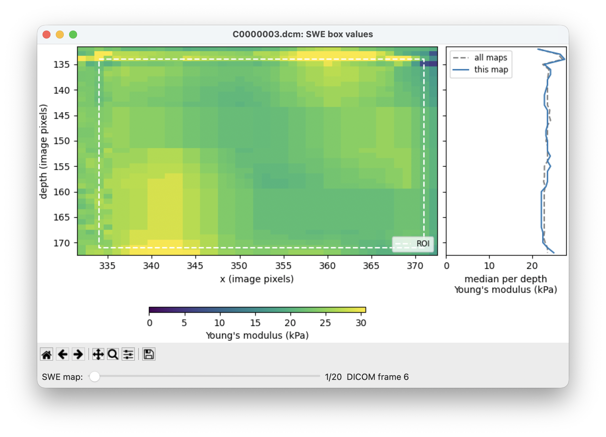

# Documentation
Swepy is a basic user interface to load and analyse shear wave elastography files recorded with **Hologic Supersonic** machines.

The analysis currently consists in a graphical preview of the elastography measurements for each frame (violin plots), and calculations of mean and median values.
Results can be exported to a `csv` or `xlsx` file.


## Get started

### Requirements
- Python 3.9 or later, with tkinter (included in the installers from [python.org](https://www.python.org/downloads/) and in Anaconda/Miniforge; on Linux you may need `sudo apt install python3-tk`).
- A DICOM file containing a cine loop
- A working desktop environment for the graphical interface

All package dependencies are installed automatically (they are listed in [pyproject.toml](pyproject.toml)).

### Installation
It is recommended to install swepy in its own virtual environment.

**Windows**
```bash
py -m venv swepy-env
swepy-env\Scripts\activate
pip install git+https://github.com/oseynnes/swepy.git
```

**macOS / Linux**
```bash
python3 -m venv swepy-env
source swepy-env/bin/activate
pip install git+https://github.com/oseynnes/swepy.git
```

If you do not have git, download the repository as a ZIP file from GitHub, unzip it, and run `pip install .` from inside the unzipped folder.
Developers can clone the repository and use `pip install -e .` instead.

### Start the interface
With the virtual environment activated, start the application with:

  ```bash
  swepy
  ```

  or

  ```bash
  python -m swepy_core
  ```

### Basic workflow
1. Load a DICOM file containing an image sequence (generally a video clip, takes a few seconds)
2. Enter the following parameters found on the image frame, then click **Set values**:
    - acquisition frequency of SWE frames (`SWE fhz` parameter, e.g. "Pen/1.6 Hz" on screen).
    - maximal scale value (`max. scale` parameter, e.g. "≥600 kPa" or "≥20.0 m/s" above the colour bar).
    - the variable of the scale (**Scale variable**): **V (m/s)** for a scale in m/s; for a scale in kPa,
      **E (kPa)** if the scanner displays Young's modulus or **μ (kPa)** if it displays shear modulus.
      The Mach30 can display either, and the image only shows "kPa": check the scanner's elasticity setting
      (and record it in your protocol). A wrong choice changes all values by a factor of 3.

|||
|---|---|


3. Click **Value map** to see the decoded values over the whole SWE box, with a depth profile.
   Stiff structures (aponeuroses, fascia) appear as bright bands: draw the ROI (rectangle or polygon) within the muscle, away from them.



4. Click **Analyse**.
5. View and export results from the **Results** tab.


### Results and outputs
The **main result** of each recording is the **mean of the medians of the included SWE maps**, in the variable
and unit measured (the **Scale variable** chosen for the analysis). It is given first in the summary
(`main_result`, with a `main_result_description` such as "Shear modulus (kPa), mean of the medians of included
SWE maps") and highlighted in the table window and in Excel files, together with the per-map median of that
variable. The measured variable is listed before the two others, which are converted from it.

The **Results** tab plots the distribution of values in each SWE map, with its median (orange dot).
Maps excluded by the quality filters are shown in grey. **Display in table** shows the summary and per-map tables,
and **Value map** shows the analysed ROI map by map.

**Quality filters** are set in the Results tab: maximal % of void pixels (default 20 %), maximal % of saturated pixels
(default 5 %), and time to ignore at the start of the recording (default 0 s). **Apply** re-applies them to all
analysed files in the list (no new analysis needed) and to future analyses; **Defaults** restores the default values.

**Export (CSV or Excel)** writes, next to each DICOM file:
- a **summary** (Excel sheet `summary`, or `<name>_summary.csv`): one value per recording.
  It starts with the main result (`main_result`), followed by the same statistic for each variable (`<variable>_mean_of_map_medians`).
  It also gives the variation between maps (`SD`, `CV%`), the median spread within maps (`median_IQR_within_maps`),
  the number of included maps, the analysis settings, and a `scale_warning` (see below).
- a **per-map table** (Excel sheet `per_map`, or `<name>.csv`): one row per SWE map, with its DICOM frame number,
  time (s), inclusion flag, % void and saturated pixels, and median, IQR, mean and SD of each variable.

**Combine selection...** writes one table with the summaries of the files selected in the list
(e.g. repeated acquisitions of the same condition), followed by their mean, SD and CV% between files.
The mean, SD and CV% of `main_result` are only given if all files were measured with the same variable.

Variables: wave velocity (m/s), shear modulus μ (kPa) and Young's modulus E (kPa).

### Settings and cached results
swepy remembers your last inputs and recent files, and caches analysis results so they can be reloaded from the **Results** tab.
These are stored in a user folder, independent of where swepy is installed:
- Windows: `%APPDATA%\swepy`
- macOS: `~/Library/Application Support/swepy`
- Linux: `~/.local/share/swepy`

Set the `SWEPY_HOME` environment variable to use another folder.

### How the analysis works
1. **One frame per SWE map.** SWE maps are refreshed less often than B-mode frames, so a cine loop shows each map over several frames.
   swepy detects the refreshes from the images (spikes in frame-to-frame change within the SWE box) and keeps the middle frame of each map.
   The `SWE fhz` value is used as a starting estimate, because actual refresh rates differ slightly from the nominal ones (e.g. every 13 frames for "1.6 Hz" at 20 frames/s).
   The DICOM frame number of each retained frame is exported in the `dicom_frame` column.
2. **Colour to value.** The colour bar shown in the image gives the colour scale (0 at the bottom, `max. scale` at the top).
   Each pixel's colour is placed along the bar's colour gradient, between the two closest bar colours, which gives its value.
   Scanners draw maps with many more colours than the ~110 rows of the bar (e.g. 1370 colours in an uncompressed
   Mach30 export), so this recovers values between bar rows instead of rounding them to the nearest row.
   The colour bar is linear in modulus, even when its scale is displayed in m/s, which swepy takes into account.
3. **Void pixels.** Pixels without colour (no SWE signal) are excluded.
4. **Statistics.** Each map is summarised by the median of its pixels, which is robust to the skewed distributions
   and stiff inclusions typical of muscle maps (IQR, mean and SD are also given). Velocity, shear modulus (μ = ρv², ρ = 1000 kg/m³)
   and Young's modulus (E = 3μ) are converted pixel by pixel.
5. **Quality filters** (Results tab). Maps are excluded from the summary if they contain more than 20 % void pixels
   or 5 % saturated pixels, or if they were recorded within a chosen time after the start of the recording (default 0 s,
   e.g. to let probe pressure settle). Thresholds can be changed and are stored with each result.
   Saturated pixels are those above 98 % of the max. scale (Edit > Settings).
6. **Stability check.** The 5 consecutive included maps with the least variable medians are flagged
   (`in_5_most_stable_maps`) and their mean is reported. Because this selection is based on the result itself,
   it is meant as a check, not as the main outcome.
7. **Scale check.** The median colour level of included pixels is reported (out of ~110 levels in the colour bar).
   Below 10 levels, values are too coarsely quantised and `scale_warning` is set: use a lower max. scale on the scanner.

### Measuring reliably
Frames of one recording share the same probe placement, so they cannot capture the main sources of measurement error.
- **Standardise acquisition:** probe aligned with the muscle fascicles (shear wave speed depends strongly on orientation in muscle),
  minimal pressure with a thick gel layer, fixed joint angle, verified rest (e.g. EMG) when measuring passive muscle.
- **Choose the lowest max. scale that does not saturate**, so the tissue spans many colour levels.
- **Draw the ROI within the muscle**, away from aponeuroses and fascia (check with **Value map**), at a consistent depth.
- **Record several acquisitions** (e.g. 3, repositioning the probe each time), use the mean of their results,
  and assess reliability between acquisitions (e.g. ICC, SEM, CV) with **Combine selection...**.
- During contractions or other changes over time, select maps with an external criterion (e.g. stable force),
  using the `time_s` column to synchronise SWE maps with other recordings.
- For muscle, the shear modulus or the wave velocity are often preferred to Young's modulus, because E = 3μ assumes an isotropic tissue
  Whatever the scanner displays, swepy converts values to all three variables.

### Notes and limitations
- The analysis currently works only for cine loops.
- **Resolution:** the colour bar has ~110 rows (≈2.7 kPa per row for a 300 kPa scale, 11 kPa for 1200 kPa).
  Values between rows are recovered from intermediate colours, but compression noise (lossy JPEG exports) blurs colours
  by about one row per pixel. Tissue values at the bottom of the scale (dark blues) are the least accurate:
  use the lowest scale that avoids saturation, so the tissue spans many colour levels.
- **DICOM export:** lossy JPEG exports (≈9 MB per clip) were within 1 % of uncompressed ones (≈230 MB) for the main result
  in our tests, with tissue mid-scale. Lossless exports (≈70 MB) keep exact colours, if maximal precision is needed.
- The SWE map **opacity** must be set to 100 % on the scanner (colours blended with the B-mode image cannot be decoded).
- The position of the colour bar in the image is fixed for the Mach30 screen layout. Check results on other layouts.
- The "standard reference" colour map (Settings) is experimental: it does not match the Supersonic colour scale exactly and gives different values.
- The percentage of saturated pixels is relative to the whole ROI (void pixels included).
- The value map display is not available for results cached by versions older than 0.2.0 (analyse the file again).
- Version 0.2.0 changed the frame selection, the colour bar sampling and the conversion of m/s scales: results can differ from earlier versions, especially for scales in m/s and for soft tissue measured with a large scale.
- Version 0.3.0 decodes colours between colour bar rows (see "How the analysis works"): results change little for tissue mid-scale
  (< 2 % in our tests) but can change more for tissue at the bottom of the scale.
- The script works with **DICOM files** and is optimised for Mach30 machines but should work with other machines from the Mach range.
Scans from Aixplorer machines also seem to be compatible but have not yet been tested thoroughly.

## Acknowledgements
I am grateful to Neil Cronin (University of Jyväskylä) for his input early in the project.  
I also thank Valentin Doguet, Antoine Nordez and Aurélie Sarcher (Nantes Université) for sharing their experience and views,
based on the development or utilisation of the excellent [ElastoGUI](https://mip.univ-nantes.fr/fr/brevets-logiciels).
The latest modifications and bug fixes were assisted with AI (Claude Opus 5.5).


## Citation
swepy is a project developed at the Norwegian School of Sport Sciences.
If needed, this code can be referenced from the cff file of this repository, or as follows:
```
@software{Seynnes_swepy_2023,
author = {Seynnes, Olivier},
license = {MIT},
month = apr,
title = {{swepy}},
url = {https://github.com/oseynnes/swepy},
year = {2023}
}
```

