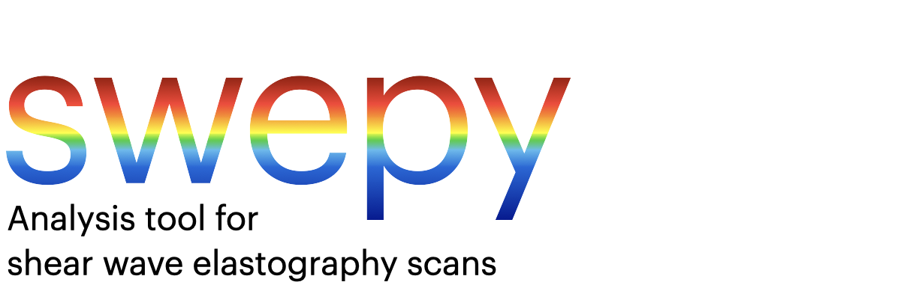
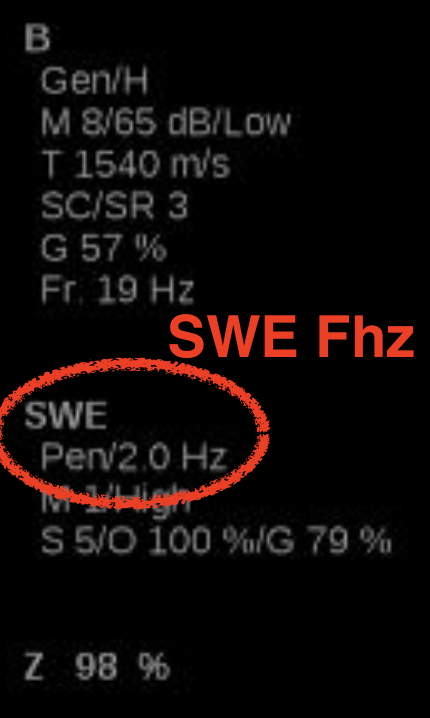
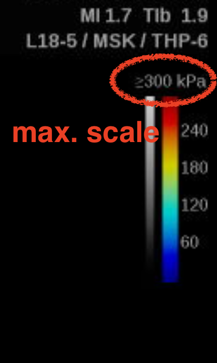
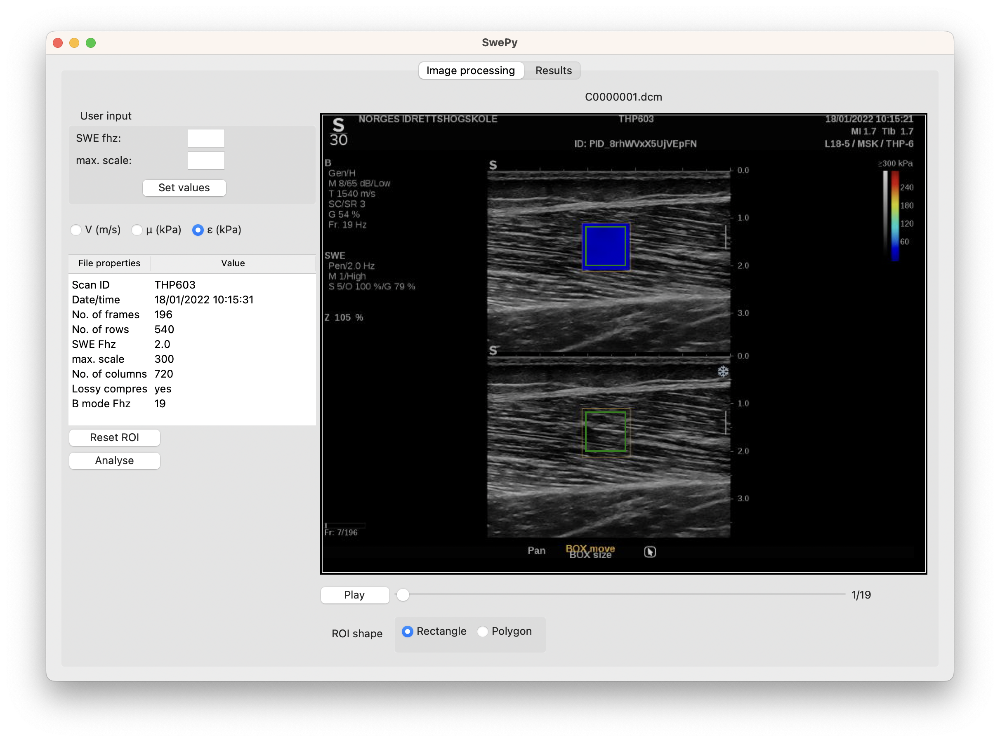
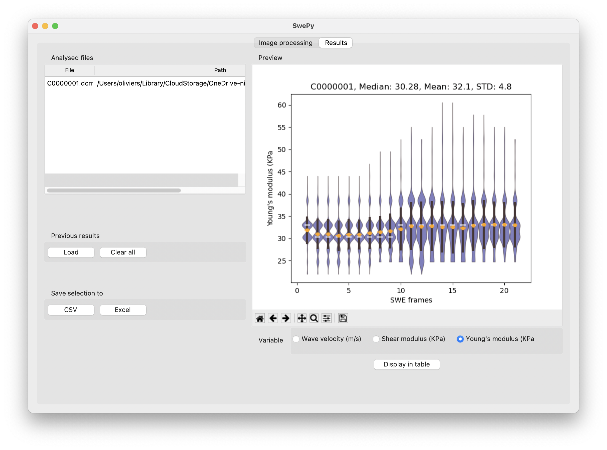

# Documentation
Swepy is a basic user interface to load and analyse shear wave elastography files recorded with **Hologic Supersonic** machines.

The analysis currently consists in a graphical preview of the elastography measurements for each frame (violin plots), and calculations of mean and median values.
Results can be exported to a `csv` or `xlsx` file.


## Get started

### Requirements
- Python 3.8 or later.  All package dependencies are listed in [requirements.txt](https://github.com/oseynnes/swepy/blob/0c40955e136abe7604a92e6e166fc4a2e2d29919/requirements.txt).
- A DICOM file containing a cine loop
- A working desktop environment for the graphical interface

### Installation
1. Clone this repository.
2. Create and activate a virtual environment if desired.
3. Install the package and its dependencies:

  ```bash
  pip install -e .
  ```

### Start the interface
You can start the application in either of these ways:

  ```bash
  swepy
  ```

  or

  ```bash
  python -m swepy_core.start
  ```

### Basic workflow
1. Load a DICOM file containing an image sequence (generally a video clip, takes a few seconds)
2. Enter the following parameters found on the image frame:
    - acquisition frequency of SWE frames (`SWE fhz` parameter).
    - maximal scale value (`max. scale` parameter, in kPa or m/s).

|||
|---|---|



3. Optionally adjust ROI size or shape.
4. Click **Analyse**.
5. View and export results from the **Results** tab.



- Export to a `csv` or `xlsx` file
  
### Notes
- The analysis currently works only for cine loops.
- The script works with **DICOM files** and is optimised for Mach30 machines but should work with other machines from the Mach range.
Scans from Aixplorer machines also seem to be compatible but have not yet been tested thoroughly.

## Acknowledgements
I am grateful to Neil Cronin (University of Jyväskylä) for his input early in the project.  
I also thank Valentin Doguet, Antoine Nordez and Aurélie Sarcher (Nantes Université) for sharing their experience and views,
based on the development or utilisation of the excellent [ElastoGUI](https://mip.univ-nantes.fr/fr/brevets-logiciels).


## Citation
swepy is a project developed at the Norwegian School of Sport Sciences.
If needed, this code can be referenced from the cff file of this repository, or as follows:
```
@software{Seynnes_swepy_2023,
author = {Seynnes, Olivier},
license = {MIT},
month = apr,
title = {{swepy}},
url = {https://github.com/oseynnes/swepy},
year = {2023}
}
```

