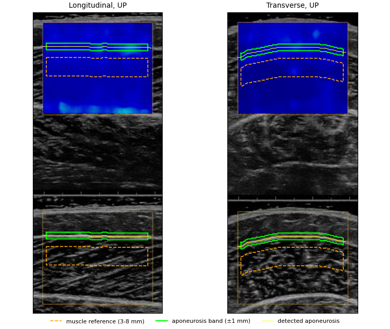

# Aponeurosis mode: measuring shear wave velocity (SWV) in aponeuroses

This guide describes the standard procedure to measure SWV in an aponeurosis with swepy.
It is written for recordings of the superficial (**UP**) and deep (**LOW**) aponeuroses of a pennate muscle,
scanned longitudinally (**LONG**) and transversally (**TRANS**), with SWE scales in m/s.

## Principle

- An aponeurosis is a thin (~1 mm) bright line on the B-mode image. In the SWE map it appears as a ridge of
  higher SWV, blurred over a few mm by the limited resolution of SWE.
- swepy locates the aponeurosis on the **B-mode image** (the bottom view, without colour), so the ROI does not
  depend on the SWE values themselves.
- The ROI is a **band of ±1 mm** around the aponeurosis line (green), across the SWE box minus a 1 mm margin.
- A **muscle reference** band (orange, 3–8 mm from the aponeurosis) is measured at the same time:
  below the superficial aponeurosis (UP), above the deep one (LOW), i.e. in the same muscle.
- The result is the **mean of the per-map medians of SWV in the band** (`mean_of_map_medians`, in m/s), with the
  muscle reference and the ratio of both.

Because of the limited resolution of SWE, the values describe the **aponeurosis region**, not the aponeurosis
tissue alone. Compare them between conditions, angles or days; do not convert them to a modulus.

## Why measure a muscle reference?

The SWE map is blurred over a few mm, so the ±1 mm band around the aponeurosis also contains some of the
neighbouring muscle. A reference measured in that muscle, in the same image, helps to interpret the
aponeurosis values:

- **Checking that the band measures the aponeurosis.** In a valid recording, SWV in the aponeurosis band is
  higher than in the adjacent muscle (`ratio_to_reference` > 1; about 1.3–1.5 in the longitudinal pilot
  recordings). A ratio close to 1 suggests that the band does not capture a distinct structure: line on the wrong
  structure, aponeurosis poorly visible, or no SWV contrast in this plane. Such recordings should be checked.
- **Telling aponeurosis changes from muscle changes.** Joint angle, contraction or blood flow restriction can
  change muscle SWV. Because of the blur, part of a muscle change also appears in the aponeurosis band.
  If the aponeurosis band changes between conditions but the muscle reference does not, the change is more
  likely specific to the aponeurosis. If both change similarly, it may come from the muscle.
- **Using the reference in statistics.** The reference can be analysed alongside the aponeurosis, e.g. with
  ROI (aponeurosis vs muscle) as a factor, to test whether conditions affect the aponeurosis differently from
  the muscle, or as a covariate.
- **Detecting acquisition differences.** Factors such as probe pressure or position affect the whole image.
  An unusual muscle reference value in one recording points to a problem with that recording.

Notes:
- The reference is placed in the **same muscle** for both aponeuroses: below the superficial aponeurosis (UP),
  above the deep one (LOW). This is why the side is set from the file name.
- The ratio is not a better outcome by itself: in the pilot data it did not reduce the day-to-day error compared
  with the aponeurosis band alone. Use it as a check and for interpretation, alongside `mean_of_map_medians`.
- Check `apo_reference_coverage_%`: when much of the reference band falls outside the SWE box, the reference is
  less reliable.

## Before starting (once)

1. **Edit > Settings**, section *Aponeurosis mode*: tick **Enable aponeurosis ROI shapes** (the mode is hidden
   by default), and check that the *Band half-width* is **1** mm (standard). Also check that the colour map
   source is **From image**. Enabling the mode also selects *ROI shape: Aponeurosis*. **Close the Settings window**
   before working on the image (clicks on the image are ignored while it is open). The setting is remembered;
   untick it to hide the aponeurosis tools again.
2. In the Results tab, check the quality filters (defaults: 20 % void, 5 % saturated, 0 s).
3. Process the files of one session folder (subject and day) together: swepy uses the aponeurosis depth of the
   previous file of the same plane and aponeurosis to suggest the line in the next one.

## Procedure for each file

1. **File > Open...** and select the file(s). Several files can be selected: they are opened one after the
   other, each after you click *Analyse*.

2. **Enter the scanner settings.** Enlarged copies of the on-screen labels are shown under *Set values*:
   - the first one is the SWE frequency (e.g. `Pen/1.1 Hz`): enter it in **SWE fhz** (here `1.1`);
   - the second one is the scale (e.g. `≥11.0 m/s`): enter it in **max. scale** (here `11`);
   - choose **V (m/s)** as *Scale variable*.

   swepy remembers the values entered for each label. The message under the labels tells you what to do:
   - green *Values recognised from screen labels*: check that the values match the labels, then click **Set values**;
   - red *New on-screen label*: the label was never seen before, so the field is empty: enter the value, then
     click **Set values**.

   If you entered a wrong value, correct it and click *Set values* again: the correction is remembered.
   (*Edit > Forget remembered screen labels* deletes all remembered values.)

3. **ROI shape: Aponeurosis** (selected when the mode is enabled, and remembered for the next files).
   swepy draws the detected aponeurosis (yellow), the band (green) and the muscle reference (orange)
   on both views.

4. **Check the line in the bottom (B-mode) view.** It must follow the aponeurosis over the whole width of the box:
   - **UP** = superficial aponeurosis of the muscle. In transverse images, two bright curved layers are often
     visible close to each other: the **upper** one is the fascia, the **lower** one is the aponeurosis.
   - **LOW** = deep aponeurosis, between the two muscles.

   If the line is on another structure, **click once on the aponeurosis** (preferably in the bottom view, near
   the middle of the box). swepy follows the bright line from your click to both sides.
   In the pilot data, the suggested line was right for all longitudinal files, but needed a click in about
   1 transverse UP file out of 7: **check transverse UP files carefully**.

5. **Check the reference side** (*Muscle reference: below (UP) / above (LOW)*). It is set from the file name
   (`_UP_` or `_LOW_`); change it only if the file name is wrong.

6. **Read the status message** under the ROI shapes:
   - green: no problem detected;
   - red warnings:

   | Warning | Meaning | What to do |
   |---|---|---|
   | *closer than 2 mm to the box edge* | the aponeurosis is at the edge of the SWE box, where artefacts occur | check the line; analyse anyway (the result is flagged `apo_edge_warning`) |
   | *depth differs by … mm from the previous file* | the line may be on another structure | check that it is on the aponeurosis; click on it if not |
   | *faint line on B-mode* | the aponeurosis is poorly visible | check carefully; use the manual line if needed |
   | *reference band mostly outside the box* | not enough muscle in the box on the reference side | analyse anyway; the reference is less reliable |

7. Optionally, click **Value map** to see the SWV map of the whole box with the ROI: in longitudinal images,
   the band should lie on a ridge of higher SWV.

8. Click **Analyse**. The result appears in the Results tab. With several files open, the next file opens.

## Manual line (if the automatic line cannot be placed on the aponeurosis)

1. Choose **ROI shape: Apo (manual)**.
2. In the bottom (B-mode) view, click **5 to 8 points on the centre of the bright aponeurosis line**, from the
   **left edge to the right edge of the SWE box** (the band only covers the extent of the clicked points).
3. **Double-click** on the last point. swepy builds the same standard ±1 mm band and muscle reference.
4. Check, then click **Analyse**. The result is labelled `apo_line_source = manual line`.

To start again, click a new first point (or *Reset ROI*).

## Last resort: polygon tool

Only if the two methods above are impossible. The band must be about ±1 mm around the aponeurosis, i.e. about
**±4–5 image pixels** at the usual pixel size (0.23 mm). With *ROI shape: Polygon*, click points along a line
about 4 pixels **above** the aponeurosis from left to right, then back along a line about 4 pixels **below** it
from right to left, and double-click to close. No muscle reference is measured, and the result is labelled
`roi_mode = polygon`: report how many files were measured this way.

## Results and quality control

The exported summary (Excel sheet `summary`) starts with:

| Field | Meaning |
|---|---|
| `mean_of_map_medians` | mean of the per-map medians of SWV in the aponeurosis band (m/s) |
| `reference_mean_of_map_medians` | same, in the muscle reference band |
| `ratio_to_reference` | aponeurosis / muscle |

and describes the ROI in fields starting with `apo_`:

| Field | Meaning |
|---|---|
| `apo_line_source` | `strongest line` or `depth of previous file` (automatic), `click`, or `manual line` |
| `apo_depth_mm` | depth of the aponeurosis below the top of the image |
| `apo_line_tilt_deg` | tilt of the aponeurosis in the image |
| `apo_min_edge_distance_mm`, `apo_edge_warning` | distance from the SWE box edge; warning below 2 mm |
| `apo_bmode_line_contrast` | visibility of the aponeurosis on B-mode (brightness vs 3 mm away) |
| `apo_band_coverage_%`, `apo_reference_coverage_%` | part of the intended bands inside the box |
| `apo_band_half_width_mm`, `apo_reference_side`, `apo_reference_limits_mm` | ROI settings used |

Recommended checks before statistics:
- list files with `apo_edge_warning = True`, and run the main analysis with and without them;
- check `median_colour_level` and `scale_warning` (precision of colour decoding);
- check `n_maps_included` (quality filters);
- *Combine selection...* (Results tab) gives one table for the selected files.
